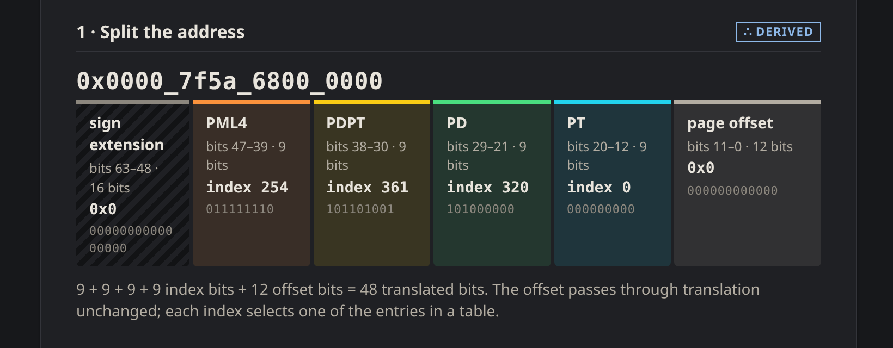
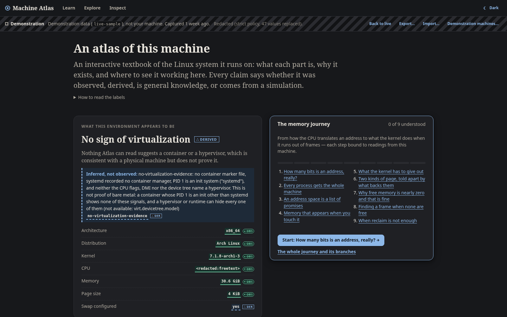
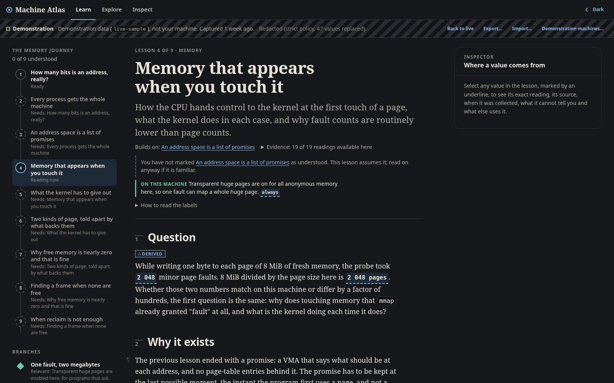
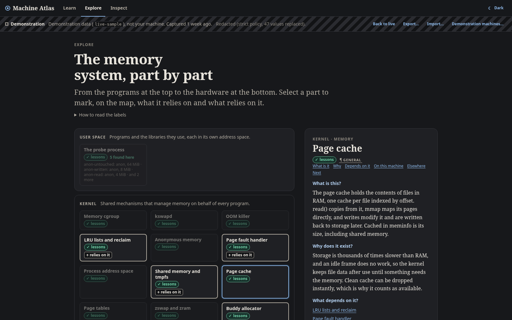
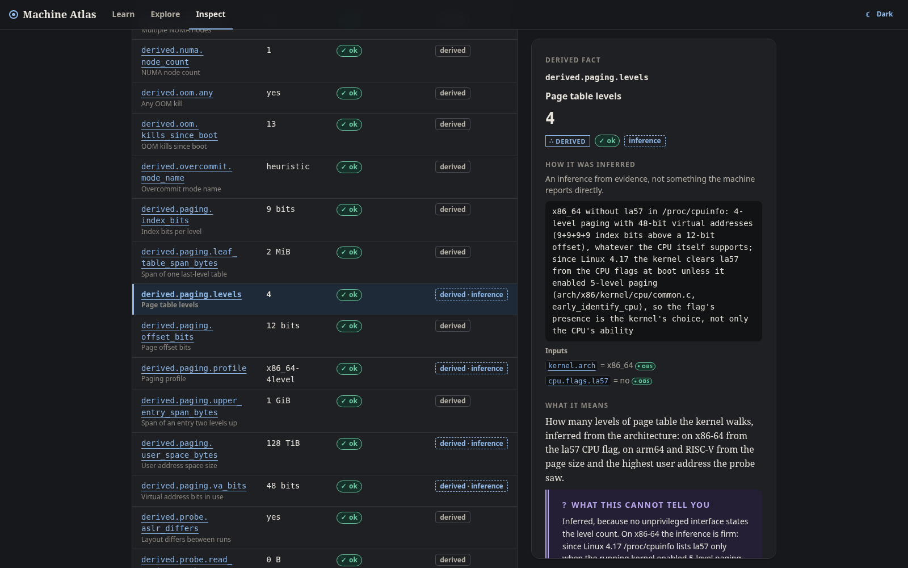

<p align="center"></p>

Machine Atlas is an interactive textbook of the Linux machine it runs on: it
reads `/proc` and `/sys` without root and teaches how memory, the CPU and its
scheduler, storage and the network work with that machine's own numbers.

## Run

```sh
git clone https://github.com/ZahakJ/machine-atlas && cd machine-atlas
go run ./cmd/atlas serve --open        # http://127.0.0.1:7373/
```

Needs Go 1.25. Or install the binary:

```sh
go install github.com/ZahakJ/machine-atlas/cmd/atlas@latest
atlas serve --open
```

Collection needs Linux (amd64, arm64; riscv64 builds). On other systems
`atlas serve` shows snapshots and the demonstration machines.

<p align="center">
  
  
</p>
<p align="center">
  
  
</p>

The captures show `live-sample`, a strict-redacted snapshot of a real desktop
taken before the CPU, storage and network tracks.

## Use

| view | |
| --- | --- |
| Learn | four tracks bound to this machine: memory (ten lessons), CPU and scheduler, storage, network (five each) |
| Explore | components by layer, with the instances found here |
| Inspect | every observation and derived fact: value, source, status, caveat |

```sh
atlas serve [--snapshot FILE | --fixture NAME] [--no-probe] [--open]
atlas lesson page-faults                     # a lesson in the terminal
atlas collect -o mine.json [--redact default|strict|none]
atlas snapshot preview|validate|redact|show FILE
atlas fixtures list
atlas experiment list | run ID [--yes]
```

Fixtures: `desktop-x86_64`, `rpi-arm64-noswap`, `alpine-container`,
`numa-server-la57`, `old-vm-cgroupv1`, `restricted` and `live-sample`.
Experiments (`fault-count`, `page-cache-residency`) are opt-in, run in a
time-limited child, and are refused outside live mode.

## How it works

- Collectors read `/proc`, `/sys`, `uname(2)` and `lsblk` unprivileged, with
  per-read and per-collector limits; every id gets a value or a status saying
  why not. A short-lived probe child maps and touches memory and reports its
  own `maps`, `smaps` and `pagemap`.
- Observations form a versioned, content-addressed snapshot; derived facts are
  recomputed from it, each with its rule and inputs.
- Lessons are Markdown with directives, bound to the snapshot in Go; every
  block is labelled OBSERVED, DERIVED, GENERAL or SIMULATED from the values it
  uses.
- `atlas serve` exposes this over a loopback-only JSON API with Host and token
  guards; the UI is plain ES modules, embedded in the binary.

## Documentation

- [Architecture](docs/ARCHITECTURE.md): layers, collectors, probe, curriculum,
  experiments, UI, HTTP API, CLI, fixtures
- [Data model](docs/DATA-MODEL.md): observations, snapshot schema, redaction,
  derived facts, catalog, versioning
- [Contributing](docs/CONTRIBUTING.md): development loop; adding a collector,
  lesson, derived fact, diagram, experiment or fixture
- [References](docs/REFERENCES.md): the sources each lesson cites

```sh
make test     # Go tests and node --test for the UI
make build    # ./atlas
```

## License

[MIT](LICENSE)
